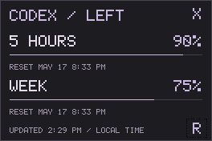

# Codex Tray

Download [CodexTray.exe](https://github.com/DanielLeonBaro/RhyseAssistant/raw/refs/heads/main/CodexTray.exe) and run it. A static pixel bracket icon appears in the Windows tray (possibly under the ^ overflow).

A tiny **264 x 176 px** dark gray widget with soft purple pixel text and one-pixel progress bars.

- Hover: remaining 5-hour and weekly percentages, with reset dates/times.
- Click: toggle the small always-on-top widget. Bars show **remaining** usage and are one physical pixel high.
- Drag the header to move. **Esc** or **X** hides it. **R** refreshes.
- Right-click the tray icon for Refresh or Exit.

Refreshes every minute, using your existing Codex ChatGPT login via the official [Codex app-server protocol](https://learn.chatgpt.com/docs/app-server). Makes only initialize and account/rateLimits/read requests; no model calls or token usage. The reader exits after each refresh. No API key, copied credentials, installer, webview, or extra packages.

Requires Windows 11's .NET Framework 4.8 and a signed-in Codex CLI or VS Code Codex extension. The app searches for codex.exe alongside itself, on PATH, in VS Code extensions, and in the per-user Codex app directory. Honors CODEX_HOME. If unavailable, sign in to Codex with ChatGPT and refresh. Hover the widget for error details.

All times use **AM/PM** and follow your Windows time zone. Missing windows show NOT REPORTED BY CODEX. On connection failure, cached values are marked STALE. Once a reset timestamp passes, its old percentage is hidden until a fresh result arrives. Nothing is estimated or automatically restored to 100%.

No automatic startup is installed. To start on login, place a shortcut to CodexTray.exe in your Windows Startup folder.

Exit the tray app before rebuilding. Build and run the small self-check: `powershell -NoProfile -ExecutionPolicy Bypass -File .\build.ps1`. For a live read check, run `CodexTray.exe --check` and inspect usage-check.txt (or error.txt on failure). `--show` opens the widget on launch.
